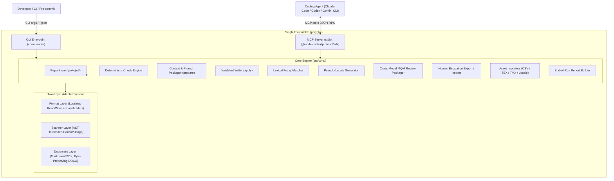

# Polyglot Architecture

> Polyglot turns the coding agent you already use into a context-aware localization engineer. The agent translates. Polyglot gives it memory, rules, and proof.

## Design Philosophy

Polyglot is a **model-free, deterministic, repo-native** CLI and MCP server built as a single TypeScript codebase compiled into one executable.

- **No LLM / MT calls:** Polyglot never makes network requests, never holds API keys, and never runs neural models. All translation and code refactoring are performed by the user's coding agent.
- **Deterministic core:** Every scan, parse, check, fuzzy match, file write, and report is repeatable and works offline.
- **Repo-native state:** All state lives in plain, diffable, canonically formatted files inside `.polyglot/`, committed alongside code.
- **Conductor about "done", toolbox about "how":** Tools are small, orthogonal primitives. `status` reports facts like `git status`. Completion is enforced via MCP server instructions, `AGENTS.md`/`CLAUDE.md` rules, the `/localize` MCP prompt, and `polyglot check` in pre-commit/CI.
- **Compact outputs:** MCP tools always return ranked summaries with counts and accept filters/pagination so they never bloat the agent's context window.

---

## High-Level System Diagram



---

## Directory Layout

```
src/
├── index.ts                 # Public programmatic exports
├── bin.ts                   # Single binary entrypoint (routes CLI vs `polyglot mcp`)
├── cli.ts                   # CLI commands (init, status, scan, check, pseudo, review, escalate, import, report, mcp)
├── mcp/
│   ├── server.ts            # MCP server registration, instructions, tools, /localize prompt
│   └── formatting.ts        # Compact, ranked response formatters & pagination helpers
├── core/
│   ├── types.ts             # Shared domain types
│   ├── store.ts             # Deterministic read/write for .polyglot/* files + Zod validation
│   ├── locales.ts           # Locale conventions (Intl.PluralRules, formality, punctuation, RTL)
│   ├── placeholders.ts      # Unified placeholder/ICU/inline-tag extractor & validator
│   ├── fuzzy.ts             # Lexical fuzzy matcher (word Levenshtein + Intl.Segmenter CJK)
│   ├── glossary.ts          # Glossary inference, matching, and change propagation
│   ├── check.ts             # Full deterministic verification engine
│   ├── prepare.ts           # Batch context + memory + glossary + conventions packager
│   ├── apply.ts             # Pre-write validation, lossless file update, memory recording
│   ├── pseudo.ts            # Pseudo-locale generator preserving placeholders & inline tags
│   ├── review.ts            # MQM cross-model review job packager & result ingestion
│   ├── escalate.ts          # CSV / XLSX / self-contained HTML export & correction import
│   ├── importers.ts         # CSV, TBX, TMX, and existing locale file importers
│   ├── report.ts            # Structured + PR Markdown end-of-run report
│   └── init.ts              # Project initialization, AGENTS.md/CLAUDE.md rule, git hook
├── formats/
│   ├── types.ts             # FormatAdapter interface
│   ├── json.ts              # Lossless JSON (nested/flat, ICU, {{x}}, {x}, linked)
│   ├── yaml.ts              # Lossless Rails YAML (yaml CST/Document, %{x}, plural subkeys)
│   └── po.ts                # Lossless Django Gettext PO (%(x)s, {x}, msgid_plural)
├── adapters/
│   ├── types.ts             # FrameworkAdapter & ScannerAdapter interfaces
│   ├── registry.ts          # Auto-detection & adapter lookup
│   ├── react.ts             # React / Next.js (next-intl, react-i18next) via @babel/parser
│   ├── vue.ts               # Vue / Nuxt (vue-i18n) via @vue/compiler-sfc + Babel
│   ├── svelte.ts            # SvelteKit (Paraglide, svelte-i18n) via svelte/compiler + Babel
│   ├── rails.ts             # Rails (built-in I18n) via ERB/Ruby AST & tree-sitter
│   └── django.ts            # Django (gettext) via Django template & Python parser
└── documents/
    ├── types.ts             # DocumentAdapter & inline tag (<x/>, <g>) types
    ├── inline-tags.ts       # Inline tag parser & validator
    ├── markdown.ts          # Lossless Markdown / MDX segmenter & writer
    └── docx.ts              # Byte-preserving OOXML DOCX extractor & writer
fixtures/                    # Deliberate-trap fixture apps & real-world DOCX corpus
examples/                    # Runnable milestone demonstration scripts
tests/                       # Unit, golden, round-trip, and MCP compactness tests
docs/                        # ARCHITECTURE.md, SCHEMAS.md, DECISIONS.md
scripts/                     # Build & standalone binary packaging scripts
```

---

## Two-Layer Adapter Architecture

Every supported software stack splits into two cleanly separated layers:

### 1. Format Layer (`src/formats/`)
**Cheap, zero-AST-scanning, lossless I/O.**
- Reads locale files into a normalized key → entry map (`value`, `plurals?`, `comments?`, `line?`).
- Writes updates **losslessly**, preserving key order, formatting, indentation, comments, blank lines, and trailing newlines.
- Declares its placeholder grammar (`icu`, `double-mustache`, `single-brace`, `percent-brace`, `python-printf`) and provides placeholder extraction.

### 2. Scanner Layer (`src/adapters/`)
**Source-code analysis using each ecosystem's reference parser.**
- Detects framework, i18n library, and locale file locations.
- Extracts **hardcoded user-facing strings** (JSX/HTML text, `aria-label`, `placeholder`, `title`, `alt`, toasts/alerts) while filtering technical tokens (CSS classes, URLs, identifiers, `data-testid`).
- Detects **string concatenations & sentence fragments** that break word order in other languages.
- Records **usage sites** for every i18n key (`file`, `line`, `component`, `elementRole`, `surroundingStrings`) and computes a deterministic SHA-256 **context fingerprint**.

---

## Document Architecture (`src/documents/`)

Documents use a **whole-document context, segment-level memory** model:
- `prepare` provides document-level metadata and neighboring paragraphs so the agent translates coherently.
- Inline markup (formatting runs, hyperlinks, fields, code spans, breaks) is encoded using XLIFF-inspired protected inline tags:
  - Self-closing placeholder: `<x id="1" type="field"/>`
  - Paired span wrapper: `<g id="2" type="bold">text</g>`
- **DOCX byte-preservation:** Polyglot never deserializes OOXML into a lossy document object model. Instead it:
  1. Unzips the `.docx` archive with `fflate`, keeping untouched entries unmodified.
  2. Parses XML parts (`word/document.xml`, headers, footers, footnotes, endnotes, comments) with a span-tracking XML tokenizer that records exact character offsets.
  3. Merges adjacent `<w:r>` runs with identical `<w:rPr>` formatting prior to extraction.
  4. Skips or protects tracked changes (`w:ins`, `w:del`, `w:moveFrom`, `w:moveTo`).
  5. On `apply`, splices translated text strictly into the target `<w:t>` spans, keeping every surrounding XML attribute, namespace, relationship, style, and drawing untouched. Unchanged reinsertion is byte-identical at the XML level.

---

## Core Data Flows

### First-Run Localization Flow
1. `scan` detects stack, i18n library, hardcoded strings, concatenations, and existing usage sites.
2. Coding agent sets up i18n library and extracts strings into source locale files.
3. `prepare` returns batches of untranslated/stale keys with source text, usage sites, neighboring strings, glossary hits, fuzzy memory matches, and target locale conventions.
4. Coding agent translates in context and calls `apply` — which validates placeholders, ICU syntax, plural rules, and inline tags before writing losslessly and recording into `.polyglot/`.
5. `check` runs all deterministic checks and returns ranked failures/warnings.
6. Coding agent fixes issues and re-runs `check` until clean.
7. `report` outputs issues caught, assumptions made, and any strings worth human or cross-model review.

### Context-Change & Glossary-Propagation Flow
- On every `scan` / `check`, usage sites are re-extracted and compared against `.polyglot/usage.json` and `.polyglot/records.json`.
- If `sourceHash` changed → flagged `stale_source`.
- If `sourceHash` is identical but `contextFingerprint` changed → flagged `context_changed` (e.g. `"Open"` moved from File menu to store-hours banner).
- If a key no longer appears in source → flagged `orphaned`.
- When a glossary entry is updated via `memory`, Polyglot scans all source strings matching the term and lists every affected key/locale pair for re-translation.
