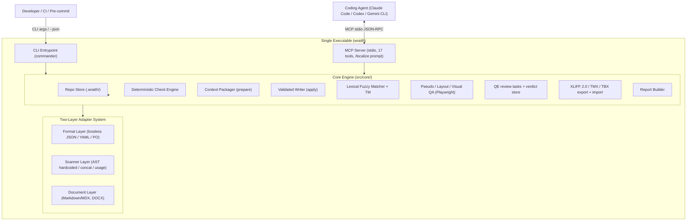

# Wraith Architecture

> Wraith turns the coding agent you already use into a context-aware localization engineer. The agent translates. Wraith gives it memory, rules, and proof.

## Design Philosophy

Wraith is a **deterministic-first, repo-native** CLI and MCP server built as a single TypeScript codebase compiled into one executable.

- **Deterministic core, no translation calls:** Scanning, extraction gating, placeholder/ICU/plural validation, fuzzy TM, lossless writes, layout and visual QA, TMS export/import, and reporting are repeatable and offline. All translation and code refactoring are performed by the user's coding agent.
- **No model calls:** Wraith never calls a model and needs no API keys. Quality review (`qe`) is done by the coding agent in a fresh context; Wraith only prepares the tasks and stores ok/flag verdicts.
- **Repo-native state:** All state lives in plain, diffable, canonically formatted files in `.wraith/`, committed alongside code.
- **Conductor about "done", toolbox about "how":** Tools are small, orthogonal primitives. Completion is enforced by MCP server instructions, `AGENTS.md`/`CLAUDE.md` rules, the `/localize` prompt, the skills in `skills/`, and `wraith check` / `extract` / `visual-qa` in pre-commit and CI.
- **Fail closed:** Every gate returns `PASS` / `FAIL` / `INCONCLUSIVE`; missing Playwright, server, baseline, or coverage is `INCONCLUSIVE` (exit 2), never `PASS`.
- **Compact outputs:** MCP tools return ranked summaries with counts and accept filters/pagination.

---

## Pipeline

```mermaid
flowchart LR
    subgraph Prep["i18n prep (deterministic)"]
        EX["extract<br/>hardcoded strings, concatenations, formatting"]
        LF["layout --fix<br/>Tailwind logical props, html dir/lang"]
        CK1["check<br/>hardcoded_formatting, directional_asset, rtl_layout_risk"]
    end
    subgraph Translate["translate (agent tokens)"]
        PR["prepare<br/>context, glossary, TM, budgets"]
        AG["coding agent translates"]
        AP["apply<br/>validated lossless write + TM"]
    end
    subgraph Verify["verify (deterministic)"]
        CK2["check<br/>placeholders, ICU, plurals, glossary, budgets"]
        PS["pseudo<br/>en-XA, ar-XB, ja-XC, th-XD, de-XE"]
        LY["layout<br/>rendered overflow, clipping, dir/lang"]
        VQ["visual-qa<br/>geometry diff vs baseline"]
    end
    subgraph QE["qe review (agent tokens, fresh context)"]
        QP["qe --prepare<br/>file-scoped tasks, same-source facts"]
        QR["agent reads each file<br/>ok / flag + reason"]
        QS["qe --submit<br/>verdicts pinned to text"]
    end
    subgraph Human["human loop (deterministic I/O)"]
        XO["export<br/>XLIFF 2.0, TMX, TBX, screenshots"]
        TMS["TMS / linguist"]
        XI["import<br/>validated, human-reviewed TM"]
    end
    EX --> LF --> CK1 --> PR --> AG --> AP --> CK2 --> PS --> LY --> VQ --> QP --> QR --> QS
    QS -->|"ok"| Done["done"]
    QS -->|"flag: agent fixes once"| AP
    QS -->|"still flagged"| XO --> TMS --> XI --> CK2
```



## Token vs deterministic boundary

| Stage | Command / MCP tool | Model tokens | Writes |
|---|---|---|---|
| Status, scan | `status`, `scan` | 0 | none |
| Extraction gate | `wraith extract` (CLI only) | 0 (agent does the refactor) | none |
| Mechanical codemods | `layout --fix` / `layout_fix` | 0 | source files |
| Context packaging | `prepare` | 0 | none |
| Translation | coding agent | **agent** | — |
| Validated write | `apply` | 0 | catalogs, `records.json`, `memory.jsonl` |
| Verification | `check` | 0 | none |
| Pseudo-locales | `pseudo` | 0 | pseudo catalogs |
| Rendered layout | `layout` | 0 | `layout.json` budgets, screenshots |
| Visual regression | `visual-qa` / `visual_qa` | 0 (no VLM) | `visual-baseline.json` (capture only), failure artifacts |
| QE task prep / status | `qe` / `qe_audit` | 0 | `qe-tasks.json` |
| QE review | coding agent (fresh context) | **agent** | `qe-verdicts.json` (via submit) |
| Cross-model review | `review` | agent of your choice | `reviews.json` (ingest) |
| TMS export | `export` / `tms_export` | 0 | export dir only |
| TMS import | `import` / `tms_import` | 0 | catalogs, `tm.json`, `qe-verdicts.json` |
| Report | `report` | 0 | none |

## System diagram



---

## Data model (`.wraith/`)

| File | Contents | Written by |
|---|---|---|
| `config.json` | `sourceLocale`, `targetLocales`, `review`, `framework`, `paths`, `layout` (`baseUrl`, `routes`, `localeUrlPattern`, `viewports`) | `init` |
| `glossary.json` | terms, DNT, per-locale translations, approved `abbreviations` | `memory`, `import` |
| `usage.json` | key → usage sites (`file`, `line`, `component`, role) + context fingerprint | `scan`/`apply` |
| `records.json` | per key/locale source hash, context fingerprint, origin, review status | `apply`, imports |
| `memory.jsonl` | append-only translation memory log | `apply` |
| `assumptions.json` | recorded agent assumptions (brand, tone, sense) | `memory` |
| `context-notes.json` | `{version:1,notes{key:{note,sourceHash,updatedAt}}}`: plain-language meaning per source string, stale when the source hash changes | `apply` (`contextNote`), `memory` set_context_note |
| `run-log.jsonl` | local, gitignored: `caught` (apply rejection, QE flag) and `applied` events, pruned to 14 days; feeds the report's "caught and fixed" | `apply`, `qe --submit` |
| `questions.json` | `{version:1,questions[{id:"Q1",keys,locale?,question,status:open\|answered\|resolved,answer?,…}]}` | `memory` add/answer/resolve_question, `wraith answer` |
| `reviews.json` | MQM review findings | `review --ingest` |
| `layout.json` | per key/locale width budgets (`maxWidthPx`, `budgetChars`), last layout run | `layout` |
| `tm.json` | `{version:1, entries:[{source,target,sourceLocale,targetLocale,key?,provenance,verifiedAt?,updatedAt}]}`; `provenance` ∈ `human-reviewed` \| `llm-generated` \| `imported`; human-reviewed outranks llm-generated in fuzzy retrieval | `apply`, `import` (XLIFF) |
| `visual-baseline.json` | `{version:1,capturedAt,baseUrl,snapshots:{"<route>\|<WxH>\|<locale>": ElementGeometrySnapshot[]}}` | `visual-qa --capture-baseline` |
| `qe-verdicts.json` | `{version:2,records[{locale,key,source,target,verdict,reason?,suggestedFix?,reviewedAt}]}` (see [QE_AND_TMS.md](QE_AND_TMS.md)) | `qe --submit`, `import` (XLIFF) |
| `artifacts/visual-qa/<locale>/<key>-<WxH>.png` + `manifest.json` | failure-only screenshots | `visual-qa` |
| `exports/tms/` | default XLIFF/TMX/TBX export bundle | `export` |

---

## Directory layout (core)

```
src/
├── bin.ts            # single binary entrypoint (CLI vs `wraith mcp`)
├── cli.ts            # init, status, scan, extract, check, pseudo, layout, visual-qa, qe,
│                     # review, escalate, import, export, report, mcp
├── mcp/server.ts     # MCP tools, annotations, instructions, /localize prompt
├── core/             # check, prepare, apply, fuzzy, glossary, pseudo, layout, codemods,
│                     # static layout/formatting scanners, review, escalate, importers, report
├── formats/          # lossless JSON / YAML / PO
├── adapters/         # React/Next, Vue/Nuxt, SvelteKit, Rails, Django scanners
└── documents/        # Markdown/MDX, byte-preserving DOCX
skills/               # agent skills (i18n-prep, localize-pr, layout-remediation, qe-review, tms-roundtrip, crowdin-sync)
.github/workflows/    # wraith.yml (CI gate + /localize), release.yml
eval/                 # independent benchmark harness + REPORT.md
```

---

## Two-layer adapter architecture

1. **Format layer (`src/formats/`)** — cheap lossless I/O. Normalized key → entry map; writes preserve key order, formatting, comments, trailing newlines. Declares placeholder grammar (`icu`, `double-mustache`, `single-brace`, `percent-brace`, `python-printf`).
2. **Scanner layer (`src/adapters/`)** — each ecosystem's reference parser. Detects framework/library, hardcoded user-facing strings, concatenations, and usage sites with a SHA-256 context fingerprint.

## Documents (`src/documents/`)

Whole-document context, segment-level memory. Inline markup is protected as `<x/>` / `<g>` tags. DOCX is never deserialized into a lossy DOM: XML parts are span-tokenized, adjacent identical runs merged, tracked changes protected, and translations spliced into `<w:t>` spans; unchanged round-trips are byte-identical.

## Core flows

- **First run:** `scan` → agent extracts (gated by `extract`) → `prepare` → agent translates → `apply` (validates placeholders/ICU/plurals/tags) → `check` until `PASS` → `pseudo` + `layout` + `visual-qa` → `qe` review (fresh context) → `report`.
- **Context change:** `sourceHash` changed → `stale_source`; same hash, new fingerprint → `context_changed`; key gone → `orphaned`. Glossary updates list every affected key/locale.
- **Human loop:** `qe` flagged → `export --only-flagged` → TMS → `import` → `human-reviewed` TM + `human-verified` verdict → `check`.
