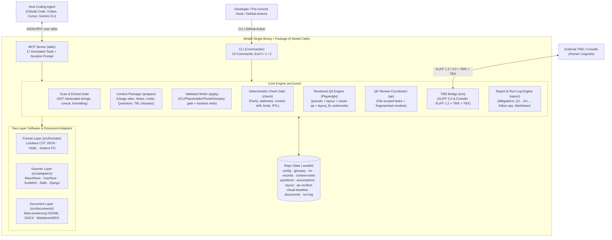
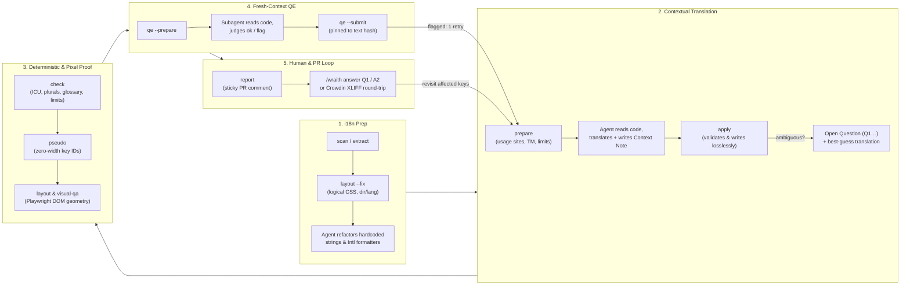

# Wraith (`wraith-mcp`) — End-to-End Architecture & System Guide

## 1. Executive Summary: What Wraith Is and Why It Exists

Traditional software and document localization is split across two broken worlds:

1. **Traditional TMS / MT pipelines** extract strings into flat files (`en.json`, `.po`, `.xliff`), strip away the UI and source code, and hand disconnected words to machine translation or human translators. Ambiguous UI strings (*"Open"*, *"Post"*, *"Save"*, *"Order"*, *"Charge"*) get translated in the wrong sense; placeholders (`{count}`, `%(name)s`) break; CLDR plural forms are missed; and German or Arabic strings overflow fixed-width buttons and break RTL layouts because nobody sees the rendered app until QA.
2. **Raw coding agents** (Claude Code, Codex, Cursor, Gemini CLI) *can* read the source code, so they get word sense right—but left to edit locale files on their own, they silently drop placeholders, corrupt JSON/YAML formatting, invent inconsistent terminology across batches, miss stale strings when English copy changes, and declare victory without ever checking the rendered pixels.

**Wraith bridges both worlds.** It is a single, deterministic, offline TypeScript CLI (`wraith`) and Model Context Protocol server (`wraith mcp`) that turns any coding agent into a localization engineer.

> **Core division of labor:** Your coding agent supplies all intelligence (code refactoring, contextual translation, and fresh-context semantic review). **Wraith itself never calls an LLM or MT API and requires zero API keys.** Wraith provides the **memory**, the **rules**, and the **deterministic proof**.

---

## 2. Core Design Principles

1. **Zero Model Calls Inside Wraith:** Every command and MCP tool in Wraith is 100% deterministic, repeatable, and offline. Model tokens are spent only by the host coding agent when translating or performing fresh-context QE review.
2. **Fail-Closed Tri-State Gates (`PASS` / `FAIL` / `INCONCLUSIVE`):** Verification gates never silently pass when unconfigured. Exit code `0` means `PASS`, `1` means `FAIL` (concrete defects found), and `2` means `INCONCLUSIVE` (e.g., unsupported stack, zero scanned source files, missing Playwright, unreachable dev server, or missing visual baseline).
3. **Repo-Native, Diffable State (`.wraith/`):** All project memory—glossaries, translation memory, usage fingerprints, Context Notes, Character Limits, Open Questions, assumptions, QE verdicts, and visual baselines—lives in canonical, human-readable JSON/JSONL files inside `.wraith/`, versioned in Git right alongside the code.
4. **Validated, Lossless Writes Only:** Agents never hand-edit target locale files. Every translation goes through `apply` (or `tms_import`), which validates placeholders, ICU syntax, CLDR plural categories, inline tags, and glossary rules *before* splicing changes losslessly into target files—preserving exact key ordering, indentation, comments, Unicode escapes, and BOMs.
5. **Advisory Memory, Never Blind Auto-Fill:** Even a 100% lexical Translation Memory match is presented to the agent with its prior component/usage context as a *suggestion to verify*, never blindly copied—so *"Open"* on a status badge (`Geöffnet`) is never auto-copied onto an *"Open"* action button (`Öffnen`).
6. **Strict Workspace Security Confinement:** Every path read or written by the CLI or MCP server is resolved through realpath/symlink checks confined to the authorized workspace root, coordinated by a re-entrant cross-process lock (`.wraith/.lock`), with ZIP-bomb/path-traversal guards on archive formats.

---

## 3. High-Level System Architecture

Wraith compiles into a single Node/SEA entrypoint (`src/bin.ts`) exposing both the human/CI CLI (`src/cli.ts`) and the stdio JSON-RPC MCP server (`src/mcp/server.ts`) backed by the same core engine.

---

## 4. End-to-End Localization Lifecycle

Wraith structures localization as a closed, verifiable loop from raw unlocalized source code all the way to human linguist sign-off and PR merge.

### Stage 1: Internationalization Readiness (`scan`, `extract`, `layout --fix`)
Before translating a single word, Wraith inspects the codebase:
- **Hardcoded UI copy & string concatenations:** Framework-native AST parsers (`@babel/parser`, `@vue/compiler-sfc`, `svelte/compiler`, Ruby/ERB, Python/Django templates) find untranslated JSX text, attributes (`placeholder`, `title`, `aria-label`, `alt`), state initializers, and broken concatenations (`"Hello " + name`) while ignoring technical strings (URLs, CSS classes, SQL, `console.*`, `Error(...)`).
- **Locale-unsafe formatting (`formatting-scanner.ts`):** Flags `.toFixed()`, locale-less `.toLocaleString()` / `Intl.*Format()`, manual currency string assembly (`"$" + price`), manual date formatting, locale-unsafe `.toUpperCase()`, and locale-less `.localeCompare()`.
- **Static layout & RTL hazards (`static-layout.ts`):** Detects fixed pixel/Tailwind widths combined with `truncate` / `overflow: hidden` / `white-space: nowrap` (across JSX `style={{}}`, Tailwind classes, CSS Modules, styled-components, and plain CSS), physical directional CSS (`ml-`, `pl-`, `text-left`), and unmirrored directional icons (`ArrowRight`, `ChevronLeft`) when an RTL target locale (`ar`, `he`, `fa`, `ur`) is configured.
- **Mechanical codemods (`wraith layout --fix` / `layout_fix`):** Deterministically rewrites Tailwind physical classes to logical equivalents (`ml-`/`mr-` → `ms-`/`me-`, `text-left` → `text-start`, `rounded-l` → `rounded-s`), converts fixed `w-*` on text elements to `min-w-*`, adds `hyphens-auto` on long-word hotspots, and injects `<html lang={...} dir={...}>` across supported frameworks.
- **Extraction gate (`wraith extract --fail-on-unextracted`):** Fails CI if a PR introduces new hardcoded strings or concatenations.

### Stage 2: Context Packaging & Validated Translation (`prepare`, `apply`, `memory`)
When the agent translates a target locale, it calls `prepare` to fetch paginated batches of keys needing work (`missing`, `stale_source`, `question_answered`, `layout_budget_exceeded`, `char_limit_exceeded`, `context_changed`, `flagged`). Every item comes packaged with:
- **Live usage sites:** `file`, `line`, enclosing `component`, HTML/JSX `element` (`<button>`, `<Badge>`), and a SHA-256 **context fingerprint**.
- **Context Note (`context-notes.json`):** A plain-language one-sentence explanation of what the source string means in the UI (written once by the agent during `apply`, pinned to `sourceHash`, and automatically marked `stale` if the English changes).
- **Character Limit (`CharLimit`):** Resolved in strict priority order:
  1. **Declared (`config.json` → `charLimits`):** Exact key or most-specific glob (`"checkout.*": 24`). **Binding** (`error` in `check`).
  2. **Rendered (`.wraith/layout.json`):** Pixel width measured in the real DOM by Playwright (`wraith layout`) converted to `budgetChars`. **Binding** (`error` in `check`).
  3. **Heuristic (`context.ts`):** IBM length-expansion budget (`×3` for ≤10 chars down to `×1.6` for 31–50 chars) applied when any usage site is a constrained UI element (`<button>`, `<Tab>`, `<NavItem>`, `<MenuItem>`, `<Badge>`, etc.). **Advisory** (`warning` in `check`).
  - Character counts are computed on **visible rendered characters** (`visibleCharCount` via `@formatjs/icu-messageformat-parser`): max branch length across ICU `plural`/`select`, inline HTML tags stripped, and nominal 4-char widths for `{placeholder}` variables so raw ICU syntax never triggers false errors.
- **Glossary & Approved Abbreviations (`glossary.json`):** Do-Not-Translate (DNT) brands, required per-locale term translations, and approved short abbreviations (`"Billing" → "Abr."`) for tight UI slots.
- **Ranked Translation Memory (`tm.json` + `memory.jsonl`):** Lexical fuzzy matches where `human-reviewed` provenance strictly outranks `llm-generated`, annotated with whether the prior usage context matches or differs from the current component.
- **Target Locale Conventions (`locales.ts`):** Text direction (`ltr`/`rtl`), required CLDR plural categories (`Intl.PluralRules`), advisory plural categories, and expected expansion ratios.
- **Open Questions (`questions.json`) & Assumptions (`assumptions.json`):**
  - If a string's meaning cannot be settled even from code (e.g., *"Post"* could be noun or verb), the agent translates its best guess, files an Open Question (`Q1`, `Q2`…), and batches questions at the end instead of blocking mid-run.
  - Non-obvious register/brand choices are recorded as numbered Assumptions (`A1`, `A2`…).
  - Humans reply in chat, CLI (`wraith answer Q1 "…"`, `wraith answer A2 "…"`), or GitHub PR comments (`/wraith answer Q1 …`). Answers and overrides become binding project decisions, reset prior agent QE verdicts on affected keys, and surface in `prepare` (`question_answered`) and `check` (`answer_pending`, `assumption_overridden`) until applied and resolved.

Every translation is written exclusively via `apply`. If any item drops a placeholder, breaks ICU syntax, misses a required plural branch, corrupts an inline tag, or violates a strict glossary term, `apply` rejects that item, logs a `caught` event to `.wraith/run-log.jsonl`, and writes valid items atomically under `.wraith/.lock`.

### Stage 3: Deterministic Verification (`check`)
`wraith check` is 100% side-effect-free (never mutates `.wraith/` or catalogs) and evaluates:
- **Catalog parity & syntax:** Missing keys, extra keys, untranslated/empty values, Gettext `#, fuzzy` entries, JSON/YAML/PO parse errors.
- **Placeholder, ICU & plural integrity:** Exact placeholder parity across `icu`, `double-mustache` (`{{x}}`), `single-brace` (`{x}`), `percent-brace` (`%{x}`), `python-printf` (`%(x)s` / `%s`), Vue `@:linked` messages and pipe plurals (`a | b | c`), i18next `_one`/`_other` suffix plurals and `keyPrefix`, Rails plural subtrees, and Gettext `Plural-Forms`.
- **Staleness & context drift:**
  - `stale_source`: Source text changed since the translation was applied or baselined (protected against staleness-laundering from earlier manual target edits).
  - `context_changed`: Source text is unchanged, but the key moved to a different component/element (`contextFingerprint` changed).
- **Terminology & consistency:** Glossary compliance (`glossary_violation`), cross-key translation inconsistency (`glossary_inconsistency`), Character Limit enforcement (`char_limit_exceeded`, `layout_budget_exceeded`, `char_limit_inferred`), and open follow-ups (`open_question`, `answer_pending`, `assumption_overridden`).
- **Coverage safety:** Fails closed (`INCONCLUSIVE`, exit `2`) if no adapter matches, `0` source files were scanned, or unscanned template/content files exist under source paths.

### Stage 4: Token-Free Rendered Layout & Visual QA (`pseudo`, `layout`, `visual-qa`)
Static checks cannot prove a button doesn't clip at 375px mobile width. Wraith verifies real browser rendering with Playwright—**using zero VLM calls and zero LLM tokens**:

1. **Zero-Width Key-Traced Pseudo-Locales (`wraith pseudo`):**
   Generates stress-test pseudo-locales tailored to configured targets:
   - `en-XA` (`expand`): Accented Latin with IBM length-scaled expansion + optional format overlay (`[⟪…⟫]`).
   - `ar-XB` (`rtl`): Right-to-left override (`RLO`/`PDF`) with `LRI`/`PDI` bidi isolation around placeholders and DNT brands.
   - `ja-XC` (`cjk`): Fullwidth CJK characters with spaces removed (tests line-breaking without whitespace).
   - `th-XD` (`tall`): Tall stacked diacritics (tests vertical `line-height` clipping).
   - `de-XE` (`long-word`): Unbreakable compound words (tests horizontal blowout).
   - **Invisible provenance:** Every pseudo string encodes its catalog key ID in invisible zero-width Unicode characters (`U+200B`..`U+200D`, `U+2060`), so any DOM node rendered in Chromium can be mapped straight back to `key` → `file:line`!
2. **Absolute Layout Check (`wraith layout`):**
   Renders configured routes at `375×812` and `1280×800`, detects horizontal/vertical overflow, CSS clipping/ellipsis, sibling box overlap, missing-glyph tofu, HTML `dir`/`lang` mismatches, and surviving hardcoded formats, and writes measured per-key `budgetChars` into `.wraith/layout.json`.
3. **Relative Geometry Regression Gate (`wraith visual-qa`):**
   Snapshots per-element DOM geometry (`width`, `height`, `lineCount`, `scrollWidth`, `clientWidth`, `overflowX`, `clipped`, `occluded` via `elementFromPoint`, `fontLoaded`, and WCAG `contrastRatio`) and diffs against `.wraith/visual-baseline.json`. Flags `line_wrap_regression`, `container_blowout`, `text_truncation`, `element_occlusion`, `missing_glyph_tofu`, and `contrast_regression`, saving cropped element screenshots *only* on failure.

### Stage 5: Fresh-Context Binary QE Review (`qe` / `qe_audit`)
Deterministic checks catch structural, formatting, and layout bugs, but cannot tell if *"Sparen"* (save money) was used instead of *"Speichern"* (save file) on a single button.
- `wraith qe --prepare` groups unreviewed translated strings (excluding any blocked by `check` errors or already `human-verified`) into **one review task per source file**, enriched with `fingerprint` (SHA-256 of `source + target`), `contextNote`, `answers`, `termBase` hits, `sameSourceElsewhere` (how identical English is translated in other files), and `projectDecisions`.
- A **fresh subagent context** (never the context that translated the batch) opens each source file, reads the actual UI code around each key, and outputs a binary verdict: `ok` or `flag` (with `reason` and optional `suggestedFix`).
- `wraith qe --submit` verifies each verdict's `fingerprint`/`target` against live catalogs (rejecting stale reviews with `text_changed` and protecting human sign-off with `human_verified`) and stores records in `.wraith/qe-verdicts.json`. Any future edit to source or target—or any new human Answer on that key—automatically resets its status to `unreviewed`.

### Stage 6: Human TMS / Crowdin Round-Trip (`export`, `import`)
Strings that remain flagged (or full release catalogs) hand off cleanly to human linguists:
- **XLIFF 2.0 (`wraith export --format xliff2`):** Standard `<unit>` files with `<mda:metadata>` (`file`, `line`, `component`, `qe_status`, `max_chars`, `max_width_px`, `tm_similarity`), `<notes>`, `<ph disp/>` placeholder protection, optional **TMX 1.4b** (`tm.tmx`), **TBX-Basic** (`glossary.tbx`), and bundled visual-QA failure screenshots.
- **Crowdin XLIFF 1.2 (`wraith export --format xliff12` + `crowdin-sync` skill):** Emits a complete, locale-independent `source.xlf` (with `<note>` translator context for Meaning, Where, Length, and Clarified answers, plus `maxwidth` on declared limits) alongside per-locale `<locale>.xlf` files (`translated`, `needs-review-translation`, `final`) and `<ph id="n">` inline tag protection.
- **Validated Import (`wraith import`):** Auto-detects XLIFF 1.2 and 2.0, maps TMS locale codes (`de-DE` → `de`), validates every target through the `apply` pipeline, writes catalogs losslessly, and—**only for units marked approved/reviewed (`reviewed` / `final` / `approved="yes"`)**—upserts `human-reviewed` TM entries and marks strings `human-verified` in `qe-verdicts.json`.

### Stage 7: End-of-Run Reporting & PR Follow-Ups (`report`, GitHub Action)
`wraith report` compiles an actionable Markdown and JSON summary:
- **Translated per locale:** Coverage, strings written in the current run burst, and QE breakdown (`ok`, `human-verified`, `flagged`, `unreviewed`).
- **Needs attention:** Remaining `check` errors and QE flags with reasons and suggested fixes.
- **Caught and fixed (Mitigations):** Errors blocked by `apply` or flagged by `qe` earlier in the run (`.wraith/run-log.jsonl`) that the agent subsequently fixed.
- **Still ambiguous (`Q1`…) & Assumptions (`A1`…):** Interactive IDs with current guesses and override status.
- **Same English, different meaning:** Homographs (e.g., *"Open"* badge vs *"Open"* button) reviewed `ok` in context, displayed alongside their Context Notes rather than noisy inconsistency warnings.

---

## 5. Two-Layer Software Adapter & Document Engine

### 5.1 Software Stacks (`src/formats/` + `src/adapters/`)
Separating file serialization from source-code scanning makes adding ecosystems modular:

| Ecosystem | Format Adapter (`src/formats/`) | Source Scanner (`src/adapters/`) | Idioms Handled |
|---|---|---|---|
| **React / Next.js** | `JsonFormatAdapter` — custom lossless JSON CST parser/splicer (`parseJsonCst` + `spliceJsonUpdate`) preserving exact key order (including integer keys like `"404"`), indentation, `\uXXXX` escapes, CRLF, and BOM | `react.ts` (`@babel/parser` TSX/JSX AST) | `next-intl` (`useTranslations`, `getTranslations`, namespaces, `t.rich`, `t.has`), `react-i18next` (`useTranslation`, `keyPrefix`, `<Trans>`, `_one`/`_other` & `_context` suffixes) |
| **Vue / Nuxt** | `JsonFormatAdapter` | `vue.ts` (`@vue/compiler-sfc` + Babel AST) | `vue-i18n` / `@nuxtjs/i18n` (`$t`, `t`, `<i18n-t>`, `@:linked` messages, `a \| b \| c` pipe plurals, unescaped `@` validation) |
| **SvelteKit** | `JsonFormatAdapter` (ignores `$schema`, supports Paraglide v2 variant `match` arrays) | `svelte.ts` (`svelte/compiler` AST + Babel) | Paraglide JS (`m.key()`), `svelte-i18n` (`$_`, `$t`) |
| **Ruby on Rails** | `YamlFormatAdapter` (`yaml` CST Document API, `lineWidth: 0`, preserves comments & anchors, prevents scalar/subtree clobbering) | `rails.ts` (ERB + Ruby scanner) | `I18n.t`, view `t(".lazy_key")` partial resolution, `%{var}` / `%<var>s` placeholders, plural subkeys |
| **Django** | `PoFormatAdapter` (lossless Gettext `.po` parser/writer preserving `#:` refs, `#.` comments, headers, `msgctxt`, `msgid_plural`, `msgstr[n]`, clearing `#, fuzzy`) | `django.ts` (Python + Django template scanner) | `gettext` / `_` / `gettext_lazy`, `pgettext`, `ngettext`, ``, ``, `` |

### 5.2 Byte-Preserving Document Engine (`src/documents/`)
- **DOCX (`src/documents/docx.ts`):** Never parses Word XML into a lossy DOM. Instead, it unpacks OOXML via `safeUnzipSync`, tokenizes XML spans across `word/document.xml`, headers, footers, footnotes, endnotes, comments, and textboxes (skipping `mc:Fallback` duplicates), merges adjacent `<w:r>` runs that share identical `<w:rPr>` styling, wraps inline formatting/hyperlinks/bookmarks in `<g id="…">` / `<x id="…"/>` tags, protects tracked deletions (`<w:del>`) and fields (`PAGE`, `DATE`), and splices translated text directly back into `<w:t>` spans. Unchanged round-trips are byte-for-byte identical. Segment state is tracked by content-derived identity `(part, sourceHash, occurrence)` in `.wraith/documents.json`.
- **Markdown / MDX (`src/documents/markdown.ts`):** Segments prose at paragraph/heading/list/blockquote boundaries while skipping frontmatter, fenced/indented code blocks, HTML comments, link definitions, and MDX `import`/`export` statements, protecting inline code, links, and `{jsxExpressions}` as inline tags.

---

## 6. `.wraith/` Repository Data Model

| Path | Tracked in Git? | Purpose |
|---|:---:|---|
| `.wraith/config.json` | Yes | Source/target locales, framework override, `paths`, `layout` routes/viewports, declared `charLimits`. |
| `.wraith/glossary.json` | Yes | Term Base: DNT flags, case sensitivity, per-locale translations, and approved `abbreviations`. |
| `.wraith/tm.json` | Yes | Structured Translation Memory with provenance (`human-reviewed` > `imported` > `llm-generated`) and `verifiedAt`. |
| `.wraith/memory.jsonl` | Yes | Append-only translation history log for auditability and lexical fuzzy matching. |
| `.wraith/records.json` | Yes | Per-key/locale `sourceHash`, `contextFingerprint`, `translation`, `origin`, and `sourceBaselines`. |
| `.wraith/context-notes.json` | Yes | Plain-language meaning per source key, pinned to `sourceHash`. |
| `.wraith/questions.json` | Yes | Open Questions (`Q1`, `Q2`…) with `open` → `answered` → `resolved` lifecycle. |
| `.wraith/assumptions.json` | Yes | Agent assumptions (`A1`, `A2`…) and binding human overrides (`overridden` → `applied`). |
| `.wraith/qe-verdicts.json` | Yes | Versioned (`v2`) binary QE records (`ok`, `flag`, `human-verified`) pinned to exact `source` + `target`. |
| `.wraith/layout.json` | Yes | Measured pixel widths (`maxWidthPx`) and character budgets (`budgetChars`) from `wraith layout`. |
| `.wraith/visual-baseline.json` | Yes | Baseline DOM element geometry per `route|WxH|locale` for `wraith visual-qa`. |
| `.wraith/documents.json` | Yes | Content-derived segment hashes and translations for incremental DOCX/Markdown batches. |
| `.wraith/reviews.json` | Yes | Findings ingested from cross-model MQM reviews (`wraith review`). |
| `.wraith/run-log.jsonl` | **No** (`.gitignore`) | Local 14-day event log (`caught` & `applied`) powering the report's *"Caught and fixed"* section. |
| `.wraith/qe-tasks.json` | **No** (`.gitignore`) | Ephemeral file-scoped QE review task bundle written by `wraith qe --prepare`. |
| `.wraith/.lock` | Ephemeral | Cross-process exclusive lock file with dead-PID and stale-age recovery. |

---

## 7. Interfaces: MCP Tools, Agent Skills & GitHub CI

### 7.1 MCP Server (`wraith mcp` — 17 Tools)
Every tool declares MCP 2025 behavioural annotations (`readOnlyHint`, `destructiveHint`, `idempotentHint`, `openWorldHint`), `outputSchema`, and `structuredContent` so host agents can auto-approve safe read-only calls:
- **Read-only (`readOnlyHint: true`):** `status`, `scan`, `prepare`, `check`, `layout`, `visual_qa`, `tms_export`, `report`.
- **Mutating, non-destructive (`destructiveHint: false`):** `memory` (discriminated union: `lookup`, `set_glossary`, `add_assumption`, `override_assumption`, `apply_override`, `add_question`, `answer_question`, `resolve_question`, `list_questions`, `set_context_note`, `add_pair`), `qe_audit` (`status` | `prepare` | `submit`), `review` (`package` | `ingest`).
- **Destructive / catalog- or code-mutating (`destructiveHint: true`):** `apply`, `import`, `pseudo`, `layout_fix`, `tms_import`, `escalate`.

### 7.2 Agent Skills (`skills/*/SKILL.md`)
Six portable Markdown playbooks constrain agent behavior with explicit tool sequences, stop conditions, and *"Never"* rules:
1. `i18n-prep` — Extract hardcoded copy/formatting and fix RTL/layout hazards on an unlocalized app.
2. `localize-pr` — Translate changed PR keys in code context, write Context Notes, enforce `check`, run fresh-context `qe-review`, and post `report`.
3. `layout-remediation` — Fix rendered `layout` / `visual-qa` failures via codemods, CSS fixes, and abbreviation budgets.
4. `qe-review` — Execute fresh-context file-by-file `ok`/`flag` semantic review and one-round remediation.
5. `crowdin-sync` — Full Crowdin CLI push/pull loop over XLIFF 1.2 with translator context and `--export-only-approved`.
6. `tms-roundtrip` — Generic TMS handoff over XLIFF 2.0 + TMX 1.4b + TBX-Basic + failure crops.

### 7.3 GitHub Action (`action.yml`) & CI Workflows
- **Composite GitHub Action (`Colton-Cogg-1999/WraithMCP@v1`):**
  - `command: gate` (default): Zero-token PR gate running `extract` + `check`, writing the full Wraith report to `$GITHUB_STEP_SUMMARY` and updating one sticky PR comment (degrading gracefully on read-only fork PR tokens while still enforcing pass/fail).
  - `command: answer`: Triggered on `/wraith answer Q1 …` or `/wraith answer A2 …` PR comments from `OWNER`/`MEMBER`/`COLLABORATOR`; passes comment text safely as argv after `--` (never through a shell), commits updated `.wraith/questions.json` / `assumptions.json`, and replies on the PR.
- **Full App Workflow Template (`examples/workflows/wraith.yml`):** Adds Playwright `visual-qa` gating, baseline artifact capture on `main`, and on-demand `/localize` agent execution (Claude Code or Codex) with automatic XLIFF artifact export for flagged keys.
- **Repo CI (`.github/workflows/ci.yml`):** Tests Wraith itself across Linux, macOS, and Windows × Node 20, 22, and 24 across `tests/` and all three independent audit suites (`audit`, `audit2`, `audit3`).

---

## 8. Security & Reliability Architecture

- **Path & Symlink Confinement (`security.ts`):** `resolveConfinedPath` walks the nearest existing ancestor via `fs.lstatSync` / `fs.readlinkSync` (catching dangling symlinks and symlink loops) to guarantee no read or write ever escapes the project root.
- **Locale Tag Validation:** Strict BCP-47 validation (`validateLocaleTag`) blocks path traversal (`../`), null bytes, or shell metacharacters disguised as locale codes.
- **Archive Bomb Protection (`safeUnzipSync`):** Inspects ZIP Central Directory headers *before* decompression to enforce entry count (`≤2000`), per-entry size (`≤32 MB`), total uncompressed size (`≤64 MB`), compression ratio (`≤120×`), and entry path traversal checks on `.docx` / `.xlsx` inputs.
- **Atomic Writes & Crash-Safe Locking:** Every state and catalog write uses temp-file-and-rename (`atomicWriteFileSync`), serialized across concurrent CLI and MCP processes by `.wraith/.lock` (`withWorkspaceLock`, re-entrant within a process, with automatic stale-PID recovery).
- **Shell-Injection-Free CI:** PR comment bodies in `action.yml` are parsed in Node and passed via `execFileSync('node', [bin, 'answer', '--', id, text])`—never interpolated into bash or `${{ ... }}` `run:` blocks.
